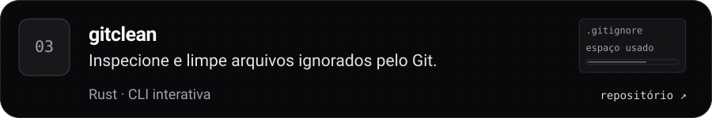
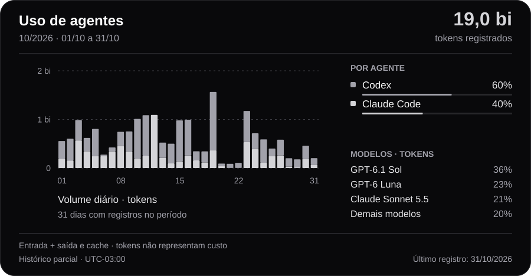

<picture>
  <source media="(prefers-reduced-motion: reduce) and (max-width: 480px)" srcset="assets/banner-mobile-still.svg">
  <source media="(prefers-reduced-motion: reduce) and (max-width: 585px), (prefers-reduced-motion: reduce) and (min-width: 768px) and (max-width: 905px)" srcset="assets/banner-compact-still.svg">
  <source media="(prefers-reduced-motion: reduce) and (max-width: 1011px)" srcset="assets/banner-medium-still.svg">
  <source media="(prefers-reduced-motion: reduce)" srcset="assets/banner-still.svg">
  <source media="(max-width: 480px)" srcset="assets/banner-mobile-still.svg">
  <source media="(max-width: 585px), (min-width: 768px) and (max-width: 905px)" srcset="assets/banner-compact-still.svg">
  <source media="(max-width: 1011px)" srcset="assets/banner-medium-still.svg">
  
</picture>

[GitHub](https://github.com/jordyfontoura) · [LinkedIn](https://www.linkedin.com/in/jordy-fontoura/) · [E-mail](mailto:jordyfontoura@outlook.com) · [Com animação](README.md)

## Projetos

<a href="https://github.com/jordyfontoura/skills"><picture>
  <source media="(prefers-reduced-motion: reduce) and (max-width: 480px)" srcset="assets/project-skills-mobile-still.svg">
  <source media="(prefers-reduced-motion: reduce)" srcset="assets/project-skills-still.svg">
  <source media="(max-width: 480px)" srcset="assets/project-skills-mobile-still.svg">
  
</picture></a>
<a href="https://github.com/jordyfontoura/TryLess"><picture>
  <source media="(prefers-reduced-motion: reduce) and (max-width: 480px)" srcset="assets/project-tryless-mobile-still.svg">
  <source media="(prefers-reduced-motion: reduce)" srcset="assets/project-tryless-still.svg">
  <source media="(max-width: 480px)" srcset="assets/project-tryless-mobile-still.svg">
  
</picture></a>
<a href="https://github.com/jordyfontoura/gitclean"><picture>
  <source media="(prefers-reduced-motion: reduce) and (max-width: 480px)" srcset="assets/project-gitclean-mobile-still.svg">
  <source media="(prefers-reduced-motion: reduce)" srcset="assets/project-gitclean-still.svg">
  <source media="(max-width: 480px)" srcset="assets/project-gitclean-mobile-still.svg">
  
</picture></a>
<a href="https://github.com/jordyfontoura/np"><picture>
  <source media="(prefers-reduced-motion: reduce) and (max-width: 480px)" srcset="assets/project-np-mobile-still.svg">
  <source media="(prefers-reduced-motion: reduce)" srcset="assets/project-np-still.svg">
  <source media="(max-width: 480px)" srcset="assets/project-np-mobile-still.svg">
  
</picture></a>
<a href="https://github.com/jordyfontoura/argus"><picture>
  <source media="(prefers-reduced-motion: reduce) and (max-width: 480px)" srcset="assets/project-argus-mobile-still.svg">
  <source media="(prefers-reduced-motion: reduce)" srcset="assets/project-argus-still.svg">
  <source media="(max-width: 480px)" srcset="assets/project-argus-mobile-still.svg">
  
</picture></a>

[TryLess no npm](https://www.npmjs.com/package/tryless) · [gitclean no crates.io](https://crates.io/crates/gitclean) · [np no crates.io](https://crates.io/crates/np-cli)

## Uso de agentes

<picture>
  <source media="(max-width: 480px)" srcset="assets/agent-usage-mobile.svg">
  <source media="(max-width: 585px), (min-width: 768px) and (max-width: 905px)" srcset="assets/agent-usage-compact.svg">
  <source media="(max-width: 1011px)" srcset="assets/agent-usage-medium.svg">
  
</picture>
