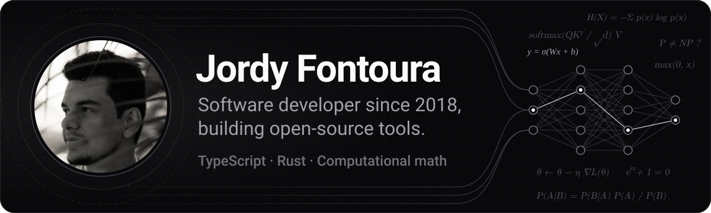
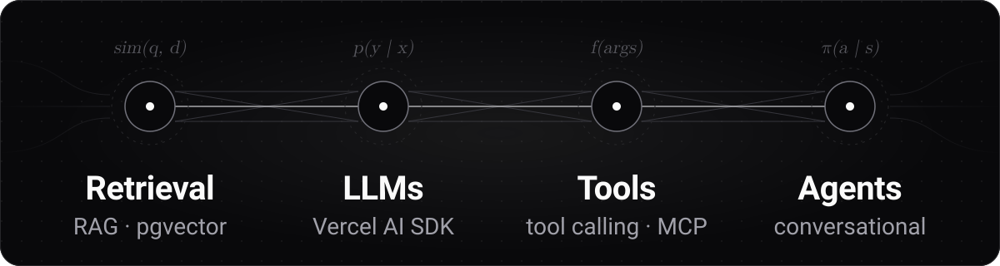
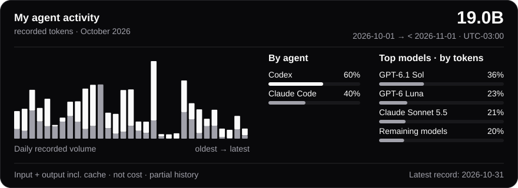

<picture>
  <source media="(max-width: 480px)" srcset="assets/banner-mobile.svg">
  <source media="(max-width: 1011px)" srcset="assets/banner-medium.svg">
  
</picture>

I'm a software engineer focused on applied AI, working with TypeScript, Python and Rust. I've been building software since 2018, and I've shipped LLM features to production and supported them after launch.

At Dois na Oito, I built generative AI features with RAG, conversational agents and MCP integrations, along with recommendation and personalization features. I was also Tech Lead at Bonaparte.

## What I work on

<picture>
  <source media="(max-width: 480px)" srcset="assets/focus-mobile.svg">
  <source media="(max-width: 1011px)" srcset="assets/focus-medium.svg">
  
</picture>

- RAG, conversational agents and integrations that connect LLMs to tools and data.
- LLM workflows for document processing.
- Voice model synthesis and comparison with Python and PyTorch.

## How I work

I use Claude, Codex and local models in my development workflow, with specs, context and instructions for agents, code review and automated checks. I publish some of that tooling as open source.

<picture>
  <source media="(max-width: 480px)" srcset="assets/agent-usage-mobile.svg">
  <source media="(max-width: 1011px)" srcset="assets/agent-usage-medium.svg">
  
</picture>

## Some things I've built

- **[skills](https://github.com/jordyfontoura/skills):** the engineering instructions I use with coding agents, in Portuguese, for Claude Code and Codex.
- **[TryLess](https://github.com/jordyfontoura/TryLess):** Rust-inspired `Result` types for error handling in TypeScript. [npm](https://www.npmjs.com/package/tryless).
- **[gitclean](https://github.com/jordyfontoura/gitclean):** a Rust CLI to inspect disk usage and clean files ignored by `.gitignore`. [crates.io](https://crates.io/crates/gitclean).

I also built [np](https://github.com/jordyfontoura/np), a package-manager proxy, and [argus](https://github.com/jordyfontoura/argus), a Windows hardware monitor with Rust and Tauri. Most of my AI work lives in private codebases.

## Stack

- **AI:** Vercel AI SDK, OpenAI SDK and embeddings, PostgreSQL/pgvector, tool calling, MCP, Python and PyTorch.
- **Backend:** TypeScript and Node.js (NestJS, Fastify), APIs, microservices, data modeling and tests.
- **Frontend:** React/Next.js and Vue/Nuxt.js.
- **Infrastructure:** Docker, Kubernetes, AWS and Google Cloud.
- **Rust:** CLIs and desktop tools, mostly in personal and open-source projects.

## Outside work

I love my wife, my two cats, and games. I started programming at 10 with **RPG Maker**, later got into frontend development and studied computational mathematics in college. In my free time, I build open-source tools in **TypeScript** and **Rust**, and occasionally make games too.

## Get in touch

Open to remote AI Engineer roles.

- [LinkedIn](https://www.linkedin.com/in/jordy-fontoura/)
- jordyfontoura@outlook.com
