<picture>
  <source media="(prefers-reduced-motion: reduce) and (max-width: 480px)" srcset="assets/banner-mobile-still.svg">
  <source media="(prefers-reduced-motion: reduce) and (max-width: 1011px)" srcset="assets/banner-medium-still.svg">
  <source media="(prefers-reduced-motion: reduce)" srcset="assets/banner-still.svg">
  <source media="(max-width: 480px)" srcset="assets/banner-mobile.svg">
  <source media="(max-width: 1011px)" srcset="assets/banner-medium.svg">
  
</picture>

[LinkedIn](https://www.linkedin.com/in/jordy-fontoura/) · [E-mail](mailto:jordyfontoura@outlook.com) · [Projetos](#projetos-abertos)

Construo software com **IA aplicada**, de RAG e agentes conversacionais a integrações com ferramentas e dados. Trabalho com **TypeScript, Python e Rust**, desenvolvo desde 2018 e acompanho o que entrego depois que entra em produção.

Na **Dois na Oito**, construí recursos de IA generativa com RAG, agentes conversacionais e integrações MCP, além de recomendação e personalização. Também fui **Tech Lead na Bonaparte**. Tenho interesse em oportunidades remotas em engenharia de IA.

## Do contexto à ação

<picture>
  <source media="(prefers-reduced-motion: reduce) and (max-width: 480px)" srcset="assets/focus-mobile-still.svg">
  <source media="(prefers-reduced-motion: reduce) and (max-width: 1011px)" srcset="assets/focus-medium-still.svg">
  <source media="(prefers-reduced-motion: reduce)" srcset="assets/focus-still.svg">
  <source media="(max-width: 480px)" srcset="assets/focus-mobile.svg">
  <source media="(max-width: 1011px)" srcset="assets/focus-medium.svg">
  
</picture>

- **Busca e agentes:** RAG, conversação e integrações entre LLMs, ferramentas e dados.
- **Documentos:** fluxos de processamento com modelos de linguagem.
- **Voz:** síntese e comparação de modelos com Python e PyTorch.

## Projetos abertos

**[skills](https://github.com/jordyfontoura/skills)** · Markdown

Instruções de engenharia em português para trabalhar com agentes no Claude Code e Codex.

**[TryLess](https://github.com/jordyfontoura/TryLess)** · TypeScript

Tratamento de erros com tipos `Result` inspirados em Rust. [Disponível no npm ↗](https://www.npmjs.com/package/tryless)

**[gitclean](https://github.com/jordyfontoura/gitclean)** · Rust

CLI para inspecionar uso de disco e limpar arquivos ignorados pelo Git. [Disponível no crates.io ↗](https://crates.io/crates/gitclean)

Também criei o [np](https://github.com/jordyfontoura/np), um proxy de gerenciadores de pacotes, e o [argus](https://github.com/jordyfontoura/argus), um monitor de hardware para Windows com Rust e Tauri. A maior parte do meu trabalho com IA está em repositórios privados.

## No meu terminal

Uso Claude, Codex e modelos locais com especificações, contexto para agentes, revisão de código e verificações automatizadas. Parte dessas ferramentas está nos projetos acima.

Uso registrado dos agentes de programação

<picture>
  <source media="(max-width: 480px)" srcset="assets/agent-usage-mobile.svg">
  <source media="(max-width: 1011px)" srcset="assets/agent-usage-medium.svg">
  
</picture>

## Ferramentas de trabalho

- **IA:** Vercel AI SDK, OpenAI SDK, embeddings, PostgreSQL/pgvector, tool calling, MCP e PyTorch.
- **Backend:** TypeScript, Node.js, NestJS, Fastify, APIs, microsserviços e modelagem de dados.
- **Frontend:** React/Next.js e Vue/Nuxt.js.
- **Infraestrutura:** Docker, Kubernetes, AWS e Google Cloud.
- **Rust:** ferramentas de terminal e aplicações desktop, principalmente em projetos pessoais e abertos.

## Fora do terminal

Amo minha esposa, meus dois gatos e jogos. Comecei a programar aos 10 anos com **RPG Maker**, passei pelo frontend e estudei matemática computacional na faculdade. No tempo livre, faço ferramentas abertas e, de vez em quando, jogos também.

---

**Vamos conversar?** [LinkedIn](https://www.linkedin.com/in/jordy-fontoura/) · [jordyfontoura@outlook.com](mailto:jordyfontoura@outlook.com)
